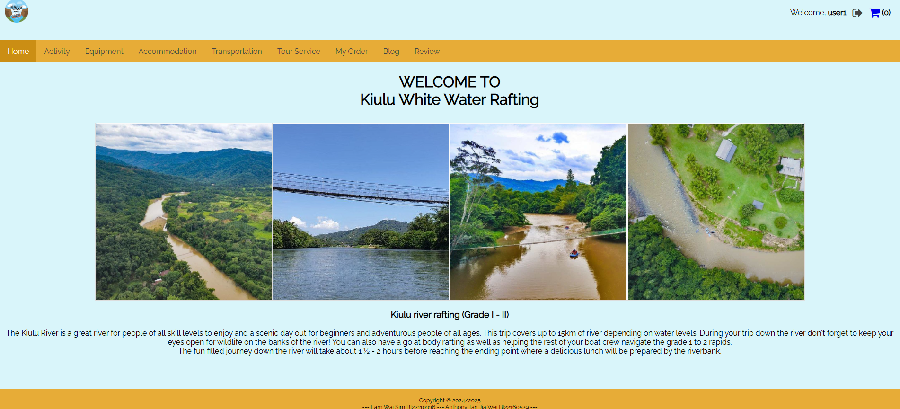
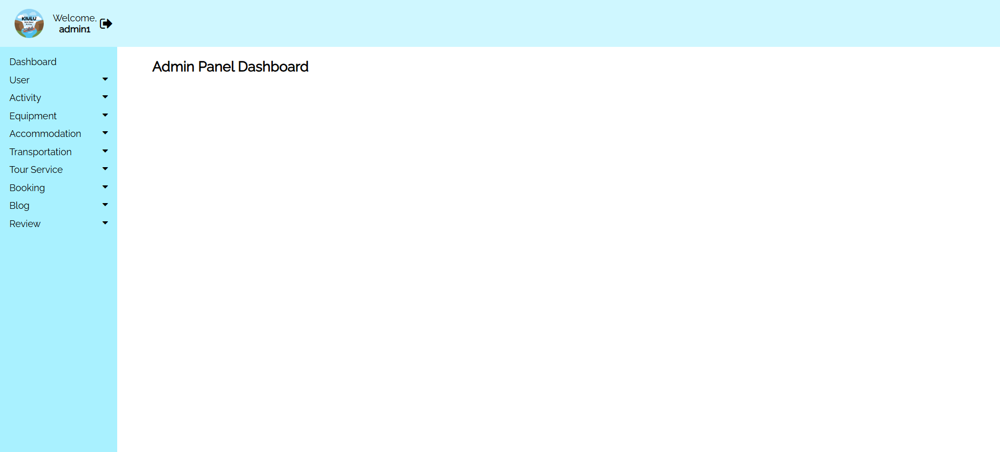

# Tourism Management System

A **Web Technology university group assignment** developed by **Sam** and **Ant**. This PHP/MySQL application supports browsing and booking tourism services, with separate customer and administrator interfaces.

## Features

- Customer registration and login, password reset, browsing and booking
- Accommodation, activities, equipment, tours, and transportation
- Cart, checkout, booking history, reviews, and blog content
- Administrator dashboard for managing tourism listings, users, bookings, reviews, categories and blog posts

## Technology

PHP, MySQL, HTML, CSS, JavaScript. Designed to run on a local Apache/PHP/MySQL stack such as XAMPP.

## Quick start (XAMPP)

1. Place the `tourism_management_system` folder inside XAMPP's `htdocs` directory.
2. Start **Apache** and **MySQL**.
3. In phpMyAdmin, create a database named `tms` and import [`database/tms.sql`](database/tms.sql).
4. If needed, update database host/username/password and the localhost URLs in `tourism_management_system/config/config.php` for your local environment.
5. Visit `http://localhost/tourism_management_system/` in your browser.

### Demo login accounts

| Role | Email | Password |
| --- | --- | --- |
| Customer | `user1@email.com` | `user1` |
| Administrator | `admin1@email.com` | `admin1` |

**Demo accounts only.** Change these credentials before deploying to a public or shared environment. The local database uses `root` with a blank password by default in the supplied configuration; this is suitable only for a properly isolated local development environment.

## Screenshots

| Customer homepage | Admin dashboard |
| --- | --- |
|  |  |

More interface screenshots are available in [`docs/screenshots/`](docs/screenshots/).

## Contributors

- **Sam** — co-developer and repository maintainer · [GitHub](https://github.com/SamanthaDAL)
- **Ant** — co-developer · [GitHub](https://github.com/Anth0ny835)

*Specific implementation responsibilities can be added once both contributors confirm them.*

## Notes

This is an academic project supplied for demonstration and portfolio purposes, not a production-hardened booking/payment service. The provided SQL dump contains example project records; review them before wider public deployment. Screenshots and uploaded images are retained from the original university submission.
